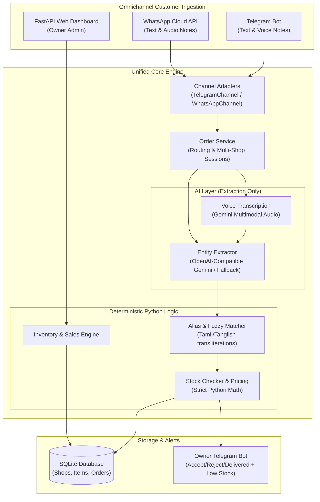

# Sollunga AI — Intelligent Grocery Order Bot & Store Management

> **"Sollunga"** (*சொல்லுங்க*) means *"Tell me"* in Tamil.

**Sollunga AI** is an AI-powered, omnichannel order-taking bot and shop management platform built for local Indian retail and kirana stores. Customers can order groceries naturally via **Telegram** or **WhatsApp** using **Tamil, English, Tanglish, or Voice Notes**, receiving immediate, deterministic price quotes and stock confirmations. 

Shop owners manage their store via real-time Telegram alerts or a sleek, mobile-first **FastAPI Web Dashboard**.

---

## 🏗️ System Architecture



---

## ✨ Key Features

- 🗣️ **Omnichannel & Multilingual:** Natural conversations in Tamil, English, or Tanglish across Telegram and WhatsApp.
- 🎙️ **Voice Note Orders:** Send voice notes in Tamil or English — automatically transcribed with Gemini audio processing.
- 🛡️ **Zero-Hallucination Pricing:** The LLM **ONLY** extracts items and units. Price calculation, inventory deduction, and totals are computed strictly in Python.
- 🏪 **Multi-Shop Ready:** Switch between multiple neighborhood stores using `/shops` or `/shop <id>`.
- ⚠️ **Smart Stock Protection:** Automatically detects out-of-stock items, caps quantities if stock is low, and dispatches real-time low-stock alerts to shop owners.
- 📱 **Interactive Order Actions:** Customers confirm or cancel orders with one tap. Owners receive interactive Telegram buttons: `[Accept]`, `[Delivered]`, `[Reject]`.
- 📊 **Mobile-First Web Dashboard:** Fast, lightweight FastAPI + Jinja2 dashboard for inventory management, real-time sales metrics, and order fulfillment.
- ⚡ **Resilient AI Pipeline:** Configurable timeouts, automatic retries with exponential backoff, and seamless fallback to a secondary LLM provider.

---

## 🚀 Setup in 5 Minutes

### 1. Clone & Set Up Virtual Environment

```bash
git clone <repo-url>
cd "Solluga AI"

python3 -m venv .venv
source .venv/bin/activate
pip install -r requirements.txt
```

### 2. Configure Environment

Copy `.env.example` to `.env` and fill in your keys:

```bash
cp .env.example .env
```

Minimal required variables in `.env`:
```ini
# Telegram Bot Token (from @BotFather)
TELEGRAM_BOT_TOKEN=123456789:ABCdefGHIjklMNOpqrsTUVwxyz

# Gemini API Key (from Google AI Studio - free tier)
LLM_BASE_URL=https://generativelanguage.googleapis.com/v1beta/openai/
LLM_API_KEY=AIzaSy...
LLM_MODEL=gemini-3.1-flash-lite

# Owner Telegram User ID (get via @userinfobot)
OWNER_TELEGRAM_ID=123456789
LOW_STOCK_THRESHOLD=3

# Dashboard Password
DASHBOARD_PASSWORD=YuvaNavi123
SECRET_KEY=super-secret-key-change-me
```

### 3. Seed Realistic Kirana Store Data

```bash
python data/seed.py
```
*Seeds 2 sample shops ("Karthik Maligai Store" and "Murugan Provisions") with authentic South Indian groceries, aliases, and prices.*

### 4. Launch Bot & Web Dashboard Together

Run the included convenience script:
```bash
./run.sh
```

Or run services individually:
```bash
# Terminal 1: Telegram Bot
python bot/main.py

# Terminal 2: Web Dashboard & WhatsApp Webhook
uvicorn web.app:app --host 0.0.0.0 --port 8000 --reload
```

Visit the Web Dashboard at: **`http://localhost:8000`** (Password: `YuvaNavi123`)  
System health status: **`http://localhost:8000/health`**

---

## 🐳 Docker Deployment

Run the complete Sollunga stack containerized:

```bash
# Build the Docker image
docker build -t sollunga-ai .

# Run the container
docker run -p 8000:8000 --env-file .env sollunga-ai
```

---

## 📲 WhatsApp Cloud API Setup (Optional)

1. Go to the [Meta Developer Portal](https://developers.facebook.com/) and create a WhatsApp Business App.
2. In the WhatsApp API Setup page, obtain your **Test Phone Number ID** and **Temporary Access Token**.
3. Set your webhook URL using Cloudflare Tunnel or ngrok:
   ```bash
   ngrok http 8000
   ```
4. In the Meta Developer App Dashboard under WhatsApp Webhook:
   - **Callback URL:** `https://<your-ngrok-url>/whatsapp/webhook`
   - **Verify Token:** Set to match `WHATSAPP_VERIFY_TOKEN` in `.env` (default: `sollunga_verify_token`).
   - Subscribe to the `messages` event field.

---

## 📸 Screenshots & UI Previews

### Customer Telegram & WhatsApp Ordering
```
Customer: "Anna 2 kg ponni arisi and 1 litre oil venum"
Sollunga: 
  🛒 Order Summary (Karthik Maligai Store):
  • rice (2.0 kg) — ₹110.00
  • oil (1.0 litre) — ₹150.00
  
  Total: ₹260.00
  [✅ Confirm Order]   [❌ Cancel]
```

### Shop Owner Telegram Notification
```
🔔 New Order #1 received!
Customer: 9876543210
Shop: Karthik Maligai Store
Items:
• rice: 2.0 kg @ ₹55.00
• oil: 1.0 litre @ ₹150.00
Total: ₹260.00

[Accept]   [Delivered]   [Reject]
```

### Mobile Web Dashboard (`http://localhost:8000`)
- **Dashboard Home:** Today's Orders, Today's Sales Revenue (₹), Low-stock alerts badge.
- **Sales & Reports:** A **Reset sales** button that zeroes Total, Today, This Week and This Month (orders and history are kept), a single-day report with a per-item breakdown, and a guarded **Clear all history** danger-zone button that permanently deletes every order to start a brand-new dashboard (items, prices and stock are kept).
- **Items Catalog:** Real-time stock counts, price adjustments, and item creation.
- **Orders Manager:** Filter by status (`pending`, `accepted`, `delivered`, `rejected`), with single-click fulfillment.

---

## 🧪 Running Tests

The test suite covers LLM entity extraction, fuzzy alias matching, inventory calculations, multi-shop isolation, channel mocks, and API routes.

```bash
pytest -v
```

All 103 tests run without external network calls using deterministic mocks and test fixtures.

---

## ⚠️ Known Limitations

1. **SQLite Write Concurrency:** SQLite handles tens of thousands of reads with ease, but uses database-level locking on writes. For large production deployments spanning hundreds of simultaneous shops, migrate `core/db.py` to PostgreSQL.
2. **WhatsApp 24-Hour Messaging Window:** Meta imposes a 24-hour customer service window on WhatsApp for inbound sessions. Out-of-session owner notifications to customers require pre-approved Meta message templates.
3. **LLM Provider Free Quotas:** Google Gemini free tier rate limits (15 RPM) can be reached under heavy burst traffic. Sollunga handles this via automatic retries and failover to `LLM_FALLBACK_BASE_URL`.
4. **Voice Audio Formats:** WhatsApp uses `.ogg` (Opus) audio notes while Telegram voice notes use `.oga`. FFmpeg is required on the host system to process raw audio buffers.

---

## 📜 License

MIT License — free for local shop owners and open-source contributions.
