<div align="center">

# 🛒 Sollunga AI

**A multilingual AI order bot and shop dashboard for Indian kirana stores. Customers order in Tamil, Tanglish or English on Telegram or WhatsApp, by text or voice note, and get exact prices from deterministic Python.**

*"Sollunga" (சொல்லுங்க) means "Tell me" in Tamil.*

[](https://github.com/Wolf-assualt/solluga-ai/actions/workflows/tests.yml)


[](LICENSE)
[](https://github.com/Wolf-assualt/solluga-ai/commits/main)

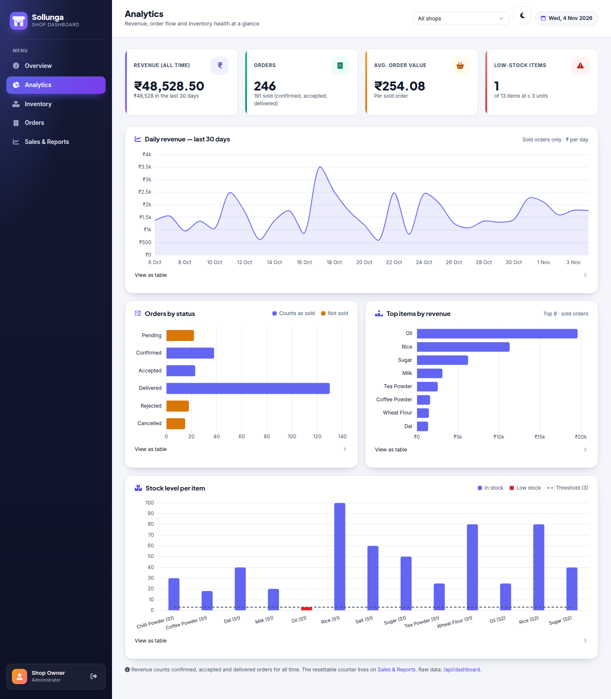

<sub>Screenshots use clearly labelled <b>sample data</b> generated by <code>data/seed_demo.py</code>.</sub>

</div>

---

## Table of contents

- [Why Sollunga?](#why-sollunga)
- [Features](#features)
- [Screenshots](#screenshots)
- [Architecture](#architecture)
- [Tech stack](#tech-stack)
- [Project in numbers](#project-in-numbers)
- [Getting started](#getting-started)
- [Usage](#usage)
- [API endpoints](#api-endpoints)
- [Environment variables](#environment-variables)
- [Project structure](#project-structure)
- [Testing](#testing)
- [Roadmap](#roadmap)
- [Contributing](#contributing)
- [License](#license)

---

## Why Sollunga?

Neighbourhood shops in Tamil Nadu take orders by phone and WhatsApp in a mix of Tamil and English, such as *"Anna 2 kg arisi, 1 litre ennai venum"*. Sollunga turns that message into a priced, stock-checked order the owner can accept with one tap.

The main design rule: **the LLM never touches money.** It only extracts `{item, qty, unit}` as JSON. Matching, stock checks, pricing and totals are plain, tested Python, so the model can't invent a price.

## Features

| | Feature | What it does |
|---|---|---|
| 🗣️ | **Multilingual ordering** | Tamil, English and Tanglish; replies in the customer's own style |
| 🎙️ | **Voice-note orders** | Telegram and WhatsApp voice notes are transcribed with Gemini audio, then parsed like text |
| 🛡️ | **Pricing without hallucination** | LLM output is validated defensively; all price and stock maths is deterministic Python |
| 🔤 | **Alias + fuzzy matching** | `arisi → rice`, `sakkarai → sugar`, `ennai → oil`, with a rapidfuzz fallback; asks the customer to clarify unknown items |
| 📦 | **Stock protection** | Caps quantities to what's available, offers the remainder, and alerts the owner on low stock |
| 🏪 | **Multi-shop** | Customers switch stores with `/shops` and `/shop <id>`; data is scoped per shop |
| 🔔 | **Owner bot** | New-order alerts with **Accept / Reject / Delivered** buttons, plus `/stock`, `/addstock`, `/setprice`, `/orders` and `/sales` |
| 💳 | **Pay Now (UPI QR)** | On-demand payment QR button. The owner uploads it once with `/setqr` |
| 📊 | **Web dashboard** | Mobile-first FastAPI + Jinja2 admin: inventory, orders, sales reports, light/dark theme |
| 📈 | **Analytics page** | `/dashboard`: KPI cards plus Chart.js revenue trend, status mix, top items and stock-vs-threshold, with a shop filter and a JSON API |
| ⚡ | **Resilient LLM pipeline** | Timeouts, retries with exponential backoff, and a secondary fallback provider |
| 🐳 | **Deploy anywhere** | Dockerfile, `run.sh` / `run.bat` launchers, `/health` endpoint |

## Screenshots

| Analytics (light) | Analytics (dark) |
|---|---|
|  | 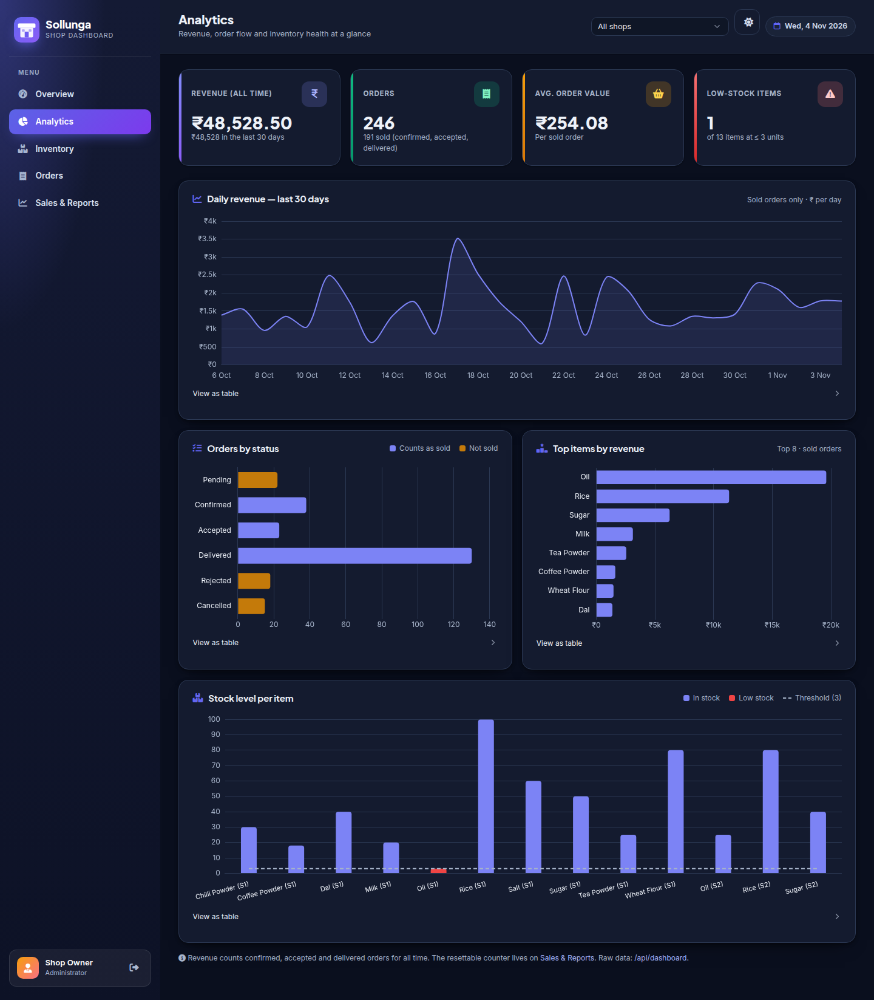 |
| **Overview** | **Orders** |
| 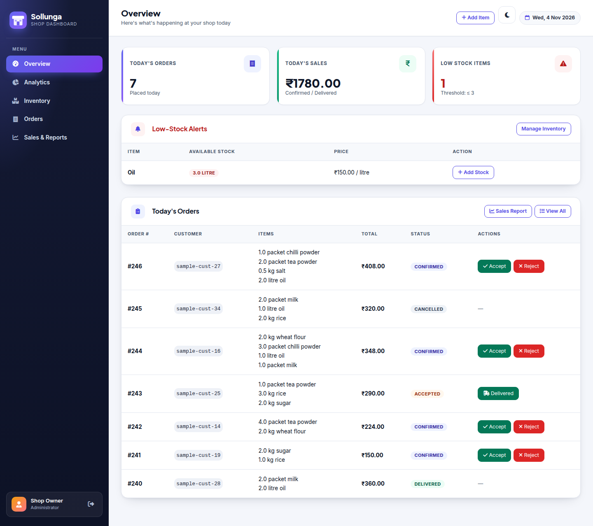 |  |
| **Inventory** | **Sales & reports** |
| 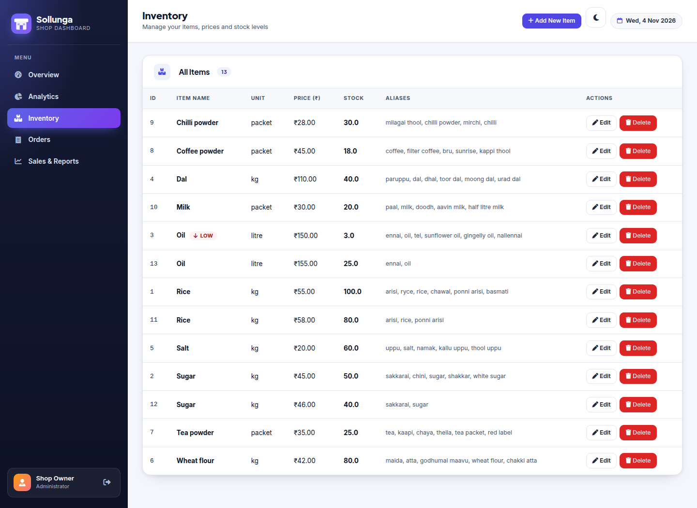 | 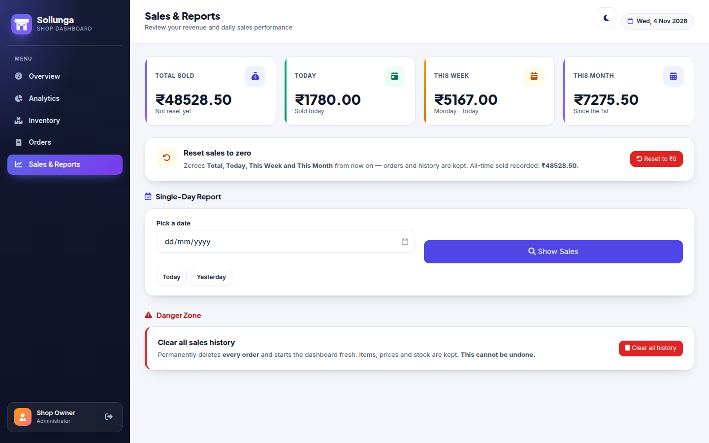 |

<details>
<summary><b>Mobile view and login</b></summary>
<br>
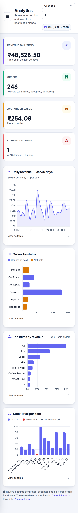
&nbsp;&nbsp;
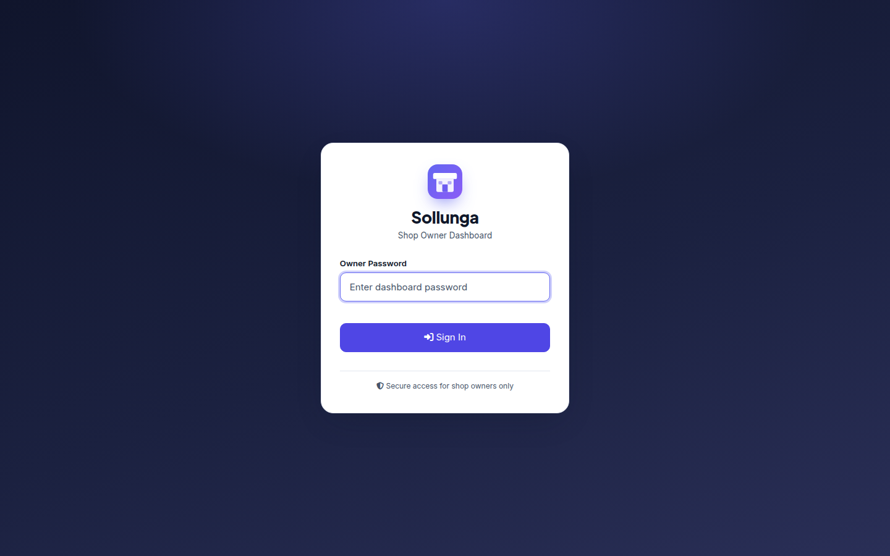
</details>

**A conversation on Telegram:**

```text
Customer: Anna 2 kg ponni arisi and 1 litre oil venum
Sollunga: 🛒 Order Summary (Karthik Maligai Store)
          • rice (2.0 kg) — ₹110.00
          • oil (1.0 litre) — ₹150.00
          Total: ₹260.00
          [✅ Confirm Order]  [❌ Cancel]
```

## Architecture

### System overview

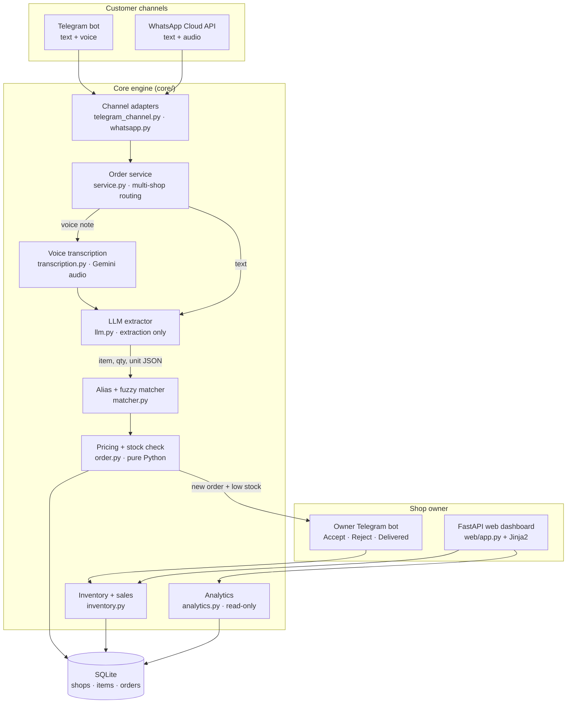

### Order data flow

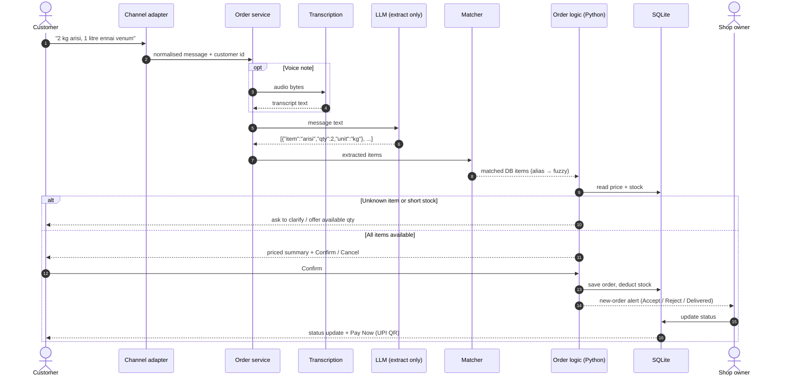

### Data model

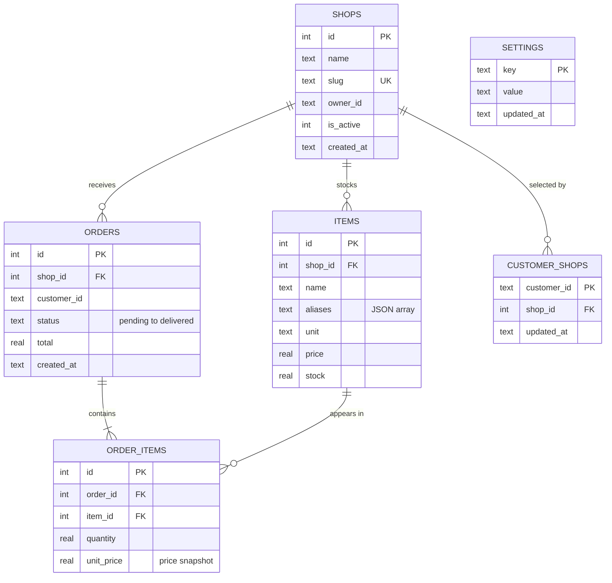

Order status lifecycle: `pending → confirmed → accepted → delivered`, with `rejected` and `cancelled` as exits. Revenue counts `confirmed`, `accepted` and `delivered`.

## Tech stack

| Layer | Technology |
|---|---|
| Language | Python 3.12 |
| Messaging | [python-telegram-bot](https://python-telegram-bot.org/) 21.6 · WhatsApp Cloud API (via `httpx`) |
| AI | OpenAI-compatible SDK → Google Gemini (default `gemini-3.1-flash-lite`), optional fallback provider · Gemini audio for voice |
| Matching | rapidfuzz + alias tables |
| Web | FastAPI · Uvicorn · Jinja2 · PicoCSS · Font Awesome · Chart.js 4.4 |
| Auth | Signed session cookie (`itsdangerous`) |
| Database | SQLite |
| Testing | pytest · pytest-asyncio · FastAPI `TestClient` · GitHub Actions |
| Tooling | Playwright (screenshots) · matplotlib (README charts) · Docker |

## Project in numbers

Both charts are generated from the repository itself by `scripts/generate_readme_charts.py`.

<p align="center">
  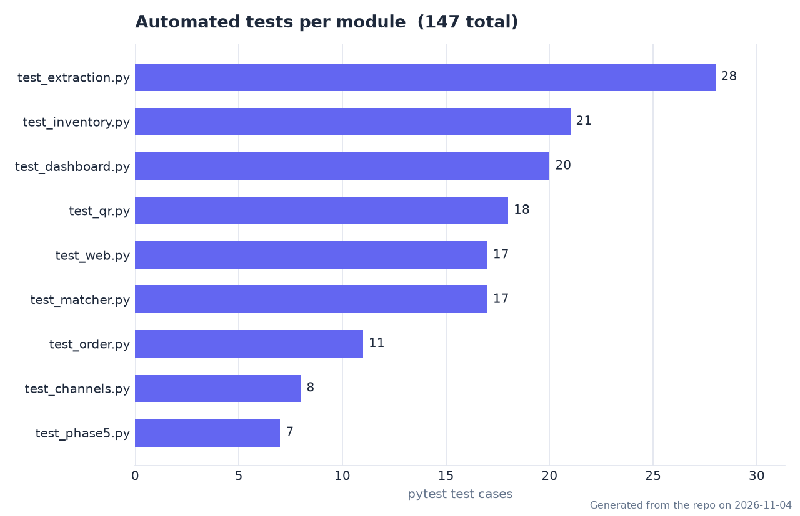
  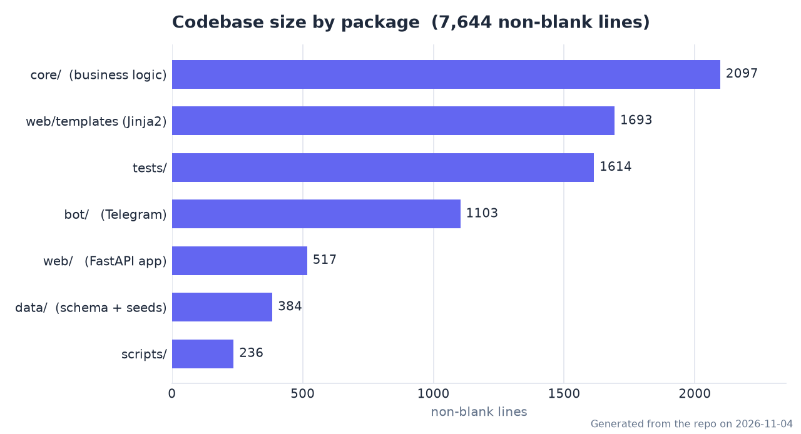
</p>

## Getting started

### Prerequisites

- Python 3.12+
- A Telegram bot token from [@BotFather](https://t.me/BotFather) (only needed for the bot)
- A Gemini API key from [Google AI Studio](https://aistudio.google.com/) (free tier works)
- `ffmpeg`, only needed for voice notes

### 1. Install

```bash
git clone https://github.com/Wolf-assualt/solluga-ai.git
cd solluga-ai

python3 -m venv .venv
source .venv/bin/activate          # Windows: .venv\Scripts\activate
python -m pip install -r requirements.txt
```

### 2. Configure

```bash
cp .env.example .env               # then fill in your own values
```

At minimum, set `TELEGRAM_BOT_TOKEN`, `LLM_BASE_URL`, `LLM_API_KEY`, `LLM_MODEL`, `OWNER_TELEGRAM_ID`, `DASHBOARD_PASSWORD` and `SECRET_KEY`. See [Environment variables](#environment-variables).

### 3. Seed the shop catalogue

```bash
python data/seed.py                # 2 demo shops with South Indian groceries + aliases
```

### 4. Run

```bash
# Web dashboard + /health + WhatsApp webhook
uvicorn web.app:app --host 0.0.0.0 --port 2626
#  → http://localhost:2626            (log in with DASHBOARD_PASSWORD)
#  → http://localhost:2626/dashboard  (analytics)

# Telegram bot (separate terminal)
python bot/main.py
```

You can also start both together with `./run.sh` (Linux/macOS) or `run.bat` (Windows).

### Try the dashboard with sample data

You don't need the bot or any API keys. This generates 30 days of **sample** orders into a separate `data/demo.db`; your real `data/sollunga.db` is never touched:

```bash
python data/seed_demo.py
DB_PATH=data/demo.db DASHBOARD_PASSWORD=demo uvicorn web.app:app --port 2627
# open http://localhost:2627/dashboard  (password: demo)
```

### Docker

```bash
docker build -t sollunga-ai .
docker run -p 2626:2626 --env-file .env sollunga-ai
```

## Usage

**Customer (Telegram or WhatsApp)**

| Message | Result |
|---|---|
| `/shops` | List shops and show the current one |
| `/shop 2` | Switch to shop #2 |
| `Anna 2 kg arisi and 1 kg sakkarai venum` | Priced summary with Confirm / Cancel |
| `5 litre ennai` (only 3 in stock) | Offers the 3 litres that are available |
| 🎙️ voice note: *"Rendu packet tea podi kudunga"* | Transcribed and handled like text |

**Shop owner (Telegram)**

| Command | Purpose |
|---|---|
| `/stock` | Current stock list with low-stock flags |
| `/addstock <item> <qty>` | Add stock |
| `/setprice <item> <price>` | Change a price |
| `/additem` | Add a new item |
| `/orders` · `/sales` | Today's orders · sales summary |
| `/setqr` · `/cancelqr` | Upload or clear the UPI payment QR |

For a scripted 2-minute walkthrough, see [DEMO.md](DEMO.md).

## API endpoints

| Method | Path | Auth | Description |
|---|---|---|---|
| `GET` | `/health` | – | Service health: DB status, item and shop counts, configured channels |
| `GET` `POST` | `/login` | – | Owner login form / submit |
| `GET` | `/logout` | – | Clear session |
| `GET` | `/` | 🔒 | Overview: today's orders, today's sales, low-stock alerts |
| `GET` | `/dashboard` | 🔒 | **Analytics page** (Chart.js). Optional `?shop_id=` |
| `GET` | `/api/dashboard` | 🔒 | Analytics JSON: KPIs, revenue by day, status mix, top items, stock. Optional `?shop_id=&days=` (7–90) |
| `GET` | `/items` | 🔒 | Inventory list |
| `GET` `POST` | `/items/new` | 🔒 | Add item |
| `GET` `POST` | `/items/edit/{item_id}` | 🔒 | Edit item |
| `POST` | `/items/delete/{item_id}` | 🔒 | Delete item |
| `GET` | `/orders` | 🔒 | Orders list with status filter |
| `POST` | `/orders/{order_id}/status` | 🔒 | Accept / reject / deliver an order |
| `GET` | `/sales` | 🔒 | Sales summary + single-day report (`?day=YYYY-MM-DD`) |
| `POST` | `/sales/reset` | 🔒 | Reset the "total sold" counter (history kept) |
| `POST` | `/sales/clear-history` | 🔒 | Permanently delete order history |
| `GET` | `/whatsapp/webhook` | verify token | Meta webhook verification |
| `POST` | `/whatsapp/webhook` | – | Incoming WhatsApp messages |
| `GET` | `/docs` | – | Auto-generated OpenAPI docs |

🔒 = requires the owner session cookie (redirects to `/login`).

## Environment variables

All variables are read from `.env` (see `.env.example`). **Never commit real values.**

| Variable | Used by | Purpose |
|---|---|---|
| `TELEGRAM_BOT_TOKEN` | bot | Telegram bot token |
| `OWNER_TELEGRAM_ID` | bot | Telegram user ID that receives owner alerts |
| `LLM_BASE_URL` | core/llm | OpenAI-compatible endpoint (Gemini by default) |
| `LLM_API_KEY` | core/llm | API key for the primary LLM |
| `LLM_MODEL` | core/llm | Model name |
| `LLM_MODELS` | core/llm | Optional list of models to try |
| `LLM_NATIVE_BASE_URL` | core/transcription | Native Gemini endpoint for audio |
| `LLM_TIMEOUT_SECONDS` | core/llm | Request timeout |
| `LLM_MAX_RETRIES` | core/llm | Retry attempts with backoff |
| `LLM_FALLBACK_BASE_URL` | core/llm | Secondary provider endpoint |
| `LLM_FALLBACK_API_KEY` | core/llm | Secondary provider key |
| `LLM_FALLBACK_MODEL` / `LLM_FALLBACK_MODELS` | core/llm | Secondary provider model(s) |
| `DB_PATH` | core/db | SQLite file path |
| `LOW_STOCK_THRESHOLD` | core/inventory | Low-stock alert level |
| `DASHBOARD_PASSWORD` | web/auth | Owner dashboard password |
| `SECRET_KEY` | web/auth | Session-cookie signing key |
| `WHATSAPP_PHONE_NUMBER_ID` | core/whatsapp | WhatsApp Cloud API phone number ID |
| `WHATSAPP_ACCESS_TOKEN` | core/whatsapp | WhatsApp Cloud API token |
| `WHATSAPP_VERIFY_TOKEN` | core/whatsapp | Webhook verification token |
| `WHATSAPP_API_VERSION` | core/whatsapp | Graph API version |
| `UPI_QR_PATH` | bot | Optional default UPI QR image |

## Project structure

```text
solluga-ai/
├── bot/                       # Telegram bot (customer + owner)
│   ├── main.py                #   entry point & handler wiring
│   ├── handlers.py            #   customer text / voice / confirm flow
│   ├── owner_handlers.py      #   owner commands & Accept/Reject/Delivered
│   ├── keyboards.py           #   inline keyboards
│   ├── messages.py            #   multilingual message templates
│   ├── qr.py                  #   UPI "Pay Now" QR handling
│   └── session.py             #   per-user conversation state
├── core/                      # channel-independent business logic
│   ├── llm.py                 #   LLM extraction (JSON only) + retries/fallback
│   ├── transcription.py       #   voice note → text (Gemini audio)
│   ├── matcher.py             #   alias + fuzzy item matching
│   ├── order.py               #   pricing, stock checks, confirm
│   ├── inventory.py           #   stock, orders, sales reporting
│   ├── analytics.py           #   read-only aggregates for /dashboard
│   ├── service.py             #   order service + multi-shop routing
│   ├── channel.py             #   channel abstraction
│   ├── telegram_channel.py    #   Telegram adapter
│   ├── whatsapp.py            #   WhatsApp Cloud API client + webhook parser
│   └── db.py                  #   SQLite connection & queries
├── web/                       # FastAPI owner dashboard
│   ├── app.py                 #   routes (dashboard, API, webhook)
│   ├── auth.py                #   session auth
│   ├── static/                #   favicon
│   └── templates/             #   Jinja2: base, home, dashboard, items, orders, sales, login
├── data/
│   ├── schema.sql             #   table definitions
│   ├── seed.py                #   shops + catalogue
│   └── seed_demo.py           #   SAMPLE order history → data/demo.db
├── scripts/
│   ├── screenshots.py         #   Playwright screenshots → docs/assets/
│   └── generate_readme_charts.py
├── tests/                     # 147 pytest tests
├── docs/assets/               # screenshots & charts used in this README
├── .github/workflows/tests.yml
├── Dockerfile · run.sh · run.bat
├── requirements.txt · requirements-dev.txt
├── .env.example · AGENTS.md · DEMO.md · LICENSE
```

## Testing

```bash
python -m pytest -q
```

The suite has **147 tests**: LLM extraction on Tanglish samples, alias and fuzzy matching, order pricing, inventory, multi-shop isolation, channel adapters, the UPI QR flow, web routes and auth, and the analytics dashboard. All external calls are mocked, so no network or API keys are needed. CI runs them on every push via GitHub Actions.

To regenerate the README assets (dev tools, installed into the venv):

```bash
python -m pip install -r requirements-dev.txt
python scripts/screenshots.py            # uses system Chrome; starts its own server on sample data
python scripts/generate_readme_charts.py
```

## Roadmap

- [x] **Phase 1:** Core order bot on Telegram (LLM extraction, matching, pricing)
- [x] **Phase 2:** Shop-owner bot, order actions and low-stock alerts
- [x] **Phase 3:** Mobile-first web dashboard
- [x] **Phase 4:** WhatsApp Cloud API and voice-note orders
- [x] **Phase 5:** Multi-shop support, reliability (retries, fallback LLM) and demo readiness
- [x] Analytics dashboard with Chart.js and a JSON API
- [ ] Move from SQLite to PostgreSQL for high write concurrency
- [ ] Pre-approved WhatsApp message templates for messages outside the 24-hour window

**Known limitations:** SQLite locks the whole database on writes. WhatsApp only allows free-form replies inside a 24-hour window. The Gemini free tier is rate-limited, which is softened by retries and the fallback provider. Voice notes need `ffmpeg` on the host.

## Contributing

Contributions are welcome.

1. Fork the repo and create a feature branch: `git checkout -b feature/my-change`
2. Follow the rules in [AGENTS.md](AGENTS.md). Most importantly, **the LLM only extracts items; all price and stock logic stays in Python.**
3. Add or update tests, and make sure `python -m pytest -q` passes.
4. Open a pull request describing the change.

## License

Released under the [MIT License](LICENSE).
